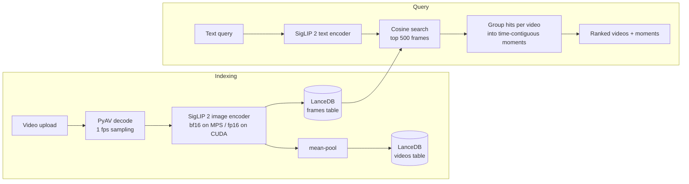

# VidSearch

Search inside your videos with natural language and jump straight to the matching moment.

VidSearch embeds sampled video frames with [SigLIP 2](https://huggingface.co/google/siglip2-base-patch16-256), stores them in an embedded [LanceDB](https://lancedb.com) index, and answers text queries with ranked videos *and* the timestamp ranges inside them that match. Everything runs locally — no hosted inference APIs — and every number below is reproducible with one command.

## Results

All numbers are produced by scripts in [`backend/eval/`](backend/eval) and committed as JSON in [`backend/eval/results/`](backend/eval/results), each stamped with the git commit, hardware, and library versions that produced it.

**MSR-VTT 1k-A text-to-video retrieval, zero-shot** (1,000 videos, 1,000 captions, JSFusion split, frames sampled at 1 fps):

| Model | R@1 ↑ | R@5 ↑ | R@10 ↑ | MdR ↓ | MnR ↓ |
|---|---:|---:|---:|---:|---:|
| CLIP ViT-B/32 (baseline, same pipeline) | 30.5 | 53.1 | 63.3 | 5 | 41.8 |
| **SigLIP 2 B/16-256 (VidSearch default)** | **39.8** | **62.9** | **73.5** | **2** | **24.6** |

Mean-pooled frame embeddings; R@K is the % of captions whose ground-truth video ranks in the top K. Max-over-frames scoring and video-to-text numbers are in the JSON files.

**Search latency** over that 1,000-video / 16,048-frame index, measured on the same `search()` path the API serves (Apple M4, 16 GB, MPS):

| Stage | p50 | p95 |
|---|---:|---:|
| Text encoding | 18 ms | 24 ms |
| Vector search (LanceDB, exact cosine) | 18 ms | 30 ms |
| End-to-end (encode + search + moment grouping) | **39 ms** | 62 ms |

Indexing throughput on the same machine: 487 frames/s decode, 16 frames/s embedding.

### Reproduce

```bash
cd backend
uv sync
uv run python -m eval.msrvtt                                   # SigLIP 2, full 1k-A (~2.2 GB download on first run)
uv run python -m eval.msrvtt --model openai/clip-vit-base-patch32   # baseline
uv run python -m eval.latency                                  # latency over the cached index
uv run python -m eval.msrvtt --limit 100                       # quick smoke run
```

Data comes from the public [`friedrichor/MSR-VTT`](https://huggingface.co/datasets/friedrichor/MSR-VTT) dataset on the Hugging Face Hub. Frame embeddings are cached per (model, fps), so re-scoring is fast after the first run.

## How it works



- **Frame-level index, video-level results.** Each sampled frame is a row in LanceDB. A query retrieves the top frames, groups them by video, and merges hits within 2.5 s of each other into *moments*. Frames below 75% of the way from a video's weakest to strongest match are dropped first, so weak neighbours don't stretch a moment. Videos scoring under half the top hit are filtered out instead of padding the results.
- **SigLIP 2 over CLIP.** SigLIP's sigmoid loss and SigLIP 2's improved training give a stronger shared image-text space at the same model size — measured above on the same pipeline.
- **Embedded vector DB.** LanceDB runs in-process on local files: no server to deploy or pay for. Tables are compacted after each write; without it, per-video fragments pushed p50 search latency from ~42 ms to ~309 ms.
- **Precision per device.** bf16 is ~1.5× faster than fp16 on Apple GPUs; CUDA uses fp16 so pre-Ampere cards (no fast bf16) still work.

## Running locally

Requirements: [uv](https://docs.astral.sh/uv/), Node 22+. Runs on Apple Silicon (MPS), NVIDIA (CUDA), or CPU.

```bash
# backend — http://localhost:8000 (OpenAPI docs at /docs)
cd backend
uv sync
uv run fastapi dev app/main.py

# frontend — http://localhost:5173 (proxies /api to the backend)
cd frontend
npm ci
npm run dev
```

Configuration is via environment variables (or `backend/.env`):

| Variable | Default | |
|---|---|---|
| `VIDSEARCH_MODEL_NAME` | `google/siglip2-base-patch16-256` | any HF SigLIP / SigLIP 2 / CLIP checkpoint |
| `VIDSEARCH_SAMPLE_FPS` | `1.0` | frames sampled per second of video |
| `VIDSEARCH_MAX_FRAMES` | `600` | long videos are thinned to this many frames |
| `VIDSEARCH_DEVICE` | auto | `cuda`, `mps`, or `cpu` |
| `VIDSEARCH_DATA_DIR` | `backend/data` | LanceDB index and uploaded videos |

### API

| Method | Path | |
|---|---|---|
| `POST` | `/videos` | upload (multipart `file`) and index a video |
| `GET` | `/videos` | list indexed videos |
| `DELETE` | `/videos/{id}` | remove a video and its frames |
| `GET` | `/videos/{id}/file` | stream the video file |
| `GET` | `/search?q=...&k=10` | ranked videos with matched moments |
| `GET` | `/benchmarks` | committed eval results |

## Project layout

```
backend/
  app/          FastAPI app: embedding.py (SigLIP 2), utilities.py (decode, moment grouping),
                database.py (LanceDB), search.py, main.py
  eval/         msrvtt.py, latency.py, metrics.py, results/*.json
  tests/        end-to-end API test on synthetic videos with a fake encoder (no model download)
frontend/       React + Vite + Chakra UI: search, library/upload, player, benchmarks
.github/        CI: ruff, pytest, frontend build
```

## Testing

```bash
cd backend && uv run pytest && uv run ruff check .
cd frontend && npm run build
```

The backend tests generate solid-colour videos, upload them through the real API, and check that a query lands on the right time range — exercising decode, indexing, search, and moment grouping without downloading a model.

## Roadmap

- Speech: Whisper transcripts (MLX / faster-whisper) with hybrid dense + BM25 retrieval and reciprocal rank fusion
- Re-ranking top candidates with a cross-modal reranker
- Shot-boundary-aware sampling instead of fixed fps
- Moment-retrieval benchmark (QVHighlights) to measure timestamp accuracy, not just video ranking
- Background indexing queue for long uploads; ANN index (IVF-PQ) for large libraries
