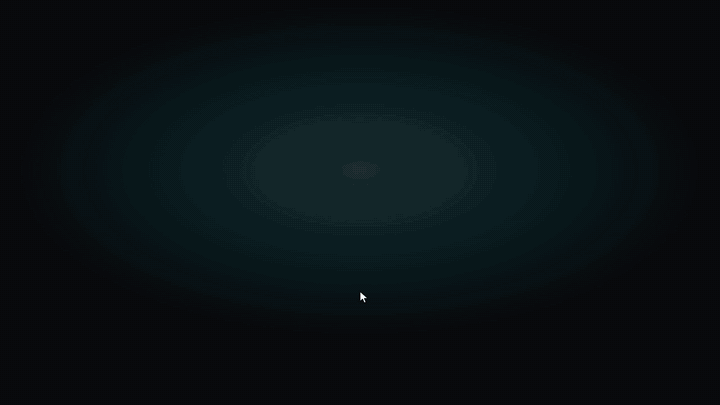

# Demo



[Full-quality MP4](demo.mp4) · 48 s · recorded from the real app by [`frontend/scripts/record-demo.mjs`](../frontend/scripts/record-demo.mjs)

The demo searches four Blender Foundation open movies, about 48 minutes of footage (2,874 frames at 1 fps), indexed locally on an Apple M4. MSR-VTT clips are research-only and sourced from YouTube, so they're deliberately not used here.

## Footage and credits

All four films are © Blender Foundation and licensed under [Creative Commons Attribution](https://creativecommons.org/licenses/by/3.0/). The demo transcodes them to 720p H.264 and does not modify their content.

| Film | License | Source |
|---|---|---|
| *Big Buck Bunny* (2008), © Blender Foundation, [bigbuckbunny.org](https://peach.blender.org) | CC BY 3.0 | [download.blender.org/peach](https://download.blender.org/peach/bigbuckbunny_movies/) |
| *Elephants Dream* (2006), © Blender Foundation, [orange.blender.org](https://orange.blender.org) | CC BY 2.5 | [download.blender.org/ED](https://download.blender.org/ED/) |
| *Sintel* (2010), © Blender Foundation, [durian.blender.org](https://durian.blender.org) | CC BY 3.0 | [download.blender.org/durian](https://download.blender.org/durian/movies/) |
| *Tears of Steel* (2012), © Blender Foundation, [mango.blender.org](https://mango.blender.org) | CC BY 3.0 | [download.blender.org/demo](https://download.blender.org/demo/movies/ToS/) |

## Reproduce the recording

Requirements: the [development setup](../CONTRIBUTING.md#development-setup), `ffmpeg`, and Google Chrome. Playwright's bundled Chromium can't decode H.264, so the recorder drives your installed Chrome.

```bash
# 1. Download the films (~1.8 GB) into the gitignored demo folder
cd backend
mkdir -p data/demo/source data/demo/films && cd data/demo/source
curl -LO https://download.blender.org/peach/bigbuckbunny_movies/BigBuckBunny_640x360.m4v.zip && unzip BigBuckBunny_640x360.m4v.zip
curl -L -o elephants_dream.mov https://download.blender.org/ED/elephantsdream-480-h264-st-aac.mov
curl -L -o tears_of_steel.mov https://download.blender.org/demo/movies/ToS/tears_of_steel_720p.mov
curl -L -o sintel.mkv https://download.blender.org/durian/movies/Sintel.2010.1080p.mkv

# 2. Transcode to web-friendly 720p MP4 (h264_videotoolbox on macOS; use libx264 elsewhere)
for pair in "BigBuckBunny_640x360.m4v|Big Buck Bunny" "elephants_dream.mov|Elephants Dream" \
            "tears_of_steel.mov|Tears of Steel" "sintel.mkv|Sintel"; do
  ffmpeg -i "${pair%%|*}" -map 0:v:0 -map '0:a:0?' -vf "scale=-2:'min(720,ih)'" \
    -c:v h264_videotoolbox -b:v 2500k -pix_fmt yuv420p -c:a aac -b:a 128k -ac 2 \
    -movflags +faststart "../films/${pair##*|}.mp4"
done
cd ../../..

# 3. Index them into a separate demo library (1 fps for the full length of each film)
VIDSEARCH_DATA_DIR=$PWD/data/demo/library VIDSEARCH_MAX_FRAMES=1200 \
  uv run python -m app.ingest folder data/demo/films

# 4. Serve the demo library, and a frontend that proxies to it
VIDSEARCH_DATA_DIR=$PWD/data/demo/library uv run uvicorn app.main:app --port 8002 &
cd ../frontend
VIDSEARCH_API=http://localhost:8002 npx vite --port 5175 &

# 5. Record, then encode for the README
DEMO_URL=http://localhost:5175 npm run record-demo        # writes docs/demo.webm
cd ../docs
ffmpeg -i demo.webm -c:v libx264 -preset slow -crf 26 -pix_fmt yuv420p -movflags +faststart demo.mp4
ffmpeg -i demo.webm -vf "fps=10,scale=800:-1:flags=lanczos,split[a][b];[a]palettegen=max_colors=128:stats_mode=diff[p];[b][p]paletteuse=dither=bayer:bayer_scale=4:diff_mode=rectangle" demo.gif
```

The recorder warms the backend's thumbnail cache before it starts, then types each query, opens the top result (playback starts at the best-matching frame), steps through the matched moments, and finishes on the Library and Benchmarks tabs. It overlays a cursor and captions, since Playwright recordings don't show the mouse pointer. To change what's shown, edit `QUERIES` in the script.
